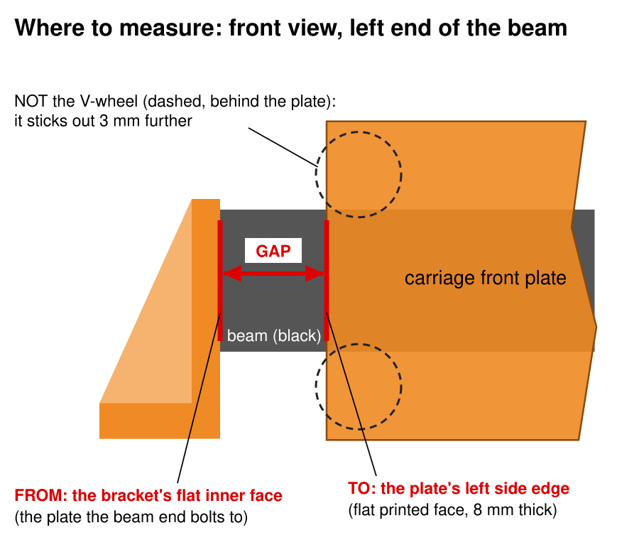

# X-axis bring-up guide (Phase 2, first milestone)

Done on 2026-11-26 (results in [`controller.md`](controller.md)); kept for rebuilding and
re-testing the X axis.

**Goal:** the printed gantry and X carriage are assembled, the X motor and X− endstop are
wired to the Creality V4.2.2 board and the 24 V supply, Marlin is flashed, and `G28 X` moves the carriage to
the endstop, stops, and sets X = 0.

**Not needed yet:** Y axis (shafts, SK10s, Y belts, Y motors and endstops), baseboard, bed,
pen holder, servo, loom, board mount. This guide is the first slice of T2.1–T2.5
(`STATUS.md` T2.7). Pin facts: [`controller.md`](controller.md); part sizes:
[`hardware.md`](hardware.md).

> **Rules for the whole session.** (1) Never plug or unplug a motor or endstop with
> 24 V on: it kills drivers. (2) Wire mains only with the plug out of the wall. (3) Keep a
> hand near the PSU switch (or the plug) whenever the carriage moves. (4) Heaters stay
> disconnected and disabled (README §7.1 rule 4).

---

## 1. What you need

### Print (default profile: PETG, 0.6 mm nozzle, 0.3 mm layers; STLs in `stl/`)

| Part | Qty | Notes |
|------|-----|-------|
| `gantry_end_bracket_left` / `_right` | 1 + 1 | Left has the idler tower and shelf |
| `x_carriage` | 1 | Front face down, no supports |
| `x_motor_mount` | 1 | The STL is already the right-hand (mirrored) part |
| `x_endstop_mount` | 1 | Foot that carries the endstop board |
| `idler_slider` | 1 (the Y idlers use the same part, ×2) | Prints upside down (top on the bed) |
| `belt_clamp` | 2 | The X belt's two ends (Y needs 4 more later) |

If you change the CAD, run `make stl` first. Print the carriage first and test-fit the nuts,
wheels and beam before printing the rest.

### Hardware

| Item | Qty |
|------|-----|
| 4020 V-slot beam, 520 mm, M5 tapped in the end bores | 1 |
| SCS10UU blocks | 4 |
| M5×20 socket head | 16 (12 into the blocks, 4 into the beam ends) |
| M5×25 socket head | 4 for the bolts that pass through the motor-mount and endstop-mount feet, plus 1 for the idler axle |
| M5×42 socket head + washer + nyloc nut | 4 each (V-wheel axles) |
| V-wheels Ø24 × 10 (625 bearings) | 4 |
| Eccentric spacers (10 mm hex) | 2 (bottom wheels) |
| M5 nut | 1 (idler axle) |
| NEMA17 motor | 1 |
| 20T GT2 pulley, Ø5 bore | 1 |
| 20T GT2 toothed idler, Ø5 bore | 1 |
| GT2 belt, 6 mm | about 1.3 m (cut to length at assembly) |
| M3×10 (motor) | 4 |
| M3×14 + M3 nut (belt clamps) | 4 + 4 |
| M3×25 + M3 nut + large M3 washer (idler tension screw) | 1 each |
| M3×12 + 2 M3 nuts (X endstop trigger on the carriage) | 1 + 2 |
| M3×6 + M3 nut (endstop board) | 2 + 2 |
| Creality-type endstop board with its cable | 1 |

The bolt counts follow the assembly model (`assemblies/gantry.py`); verify when you build.

### Electronics and tools

Creality V4.2.2 board (drivers soldered on), the 24 V PSU, mains cable and plug, micro-USB cable
(data, not charge-only), microSD card (FAT32, to flash) and a way to write it from the Mac,
multimeter, small ceramic or plastic screwdriver (Vref pot), hex keys, ruler or calipers, a flat
table, a non-slip mat.

---

## 2. Assemble the mechanics

1. **Carriage.** Press M3 nuts into their pockets (see the part's docstring). Mount the 4
   V-wheels with M5×42 bolts from the front (washer and head sit in the counterbores,
   nyloc nut on the wheel side). The bottom pair goes on the eccentric spacers (the Ø7.1
   boss goes into the plate). Leave the bottom wheels loose and the eccentrics open.
2. **Carriage on the beam, then the brackets.** Slide the carriage onto the beam **before**
   the brackets go on (they close the ends). Then bolt each bracket to a beam end with 2 ×
   M5×20 into the end bores.
3. **Preload.** Turn the eccentrics until the carriage rolls with a light, even drag and no
   rattle; tighten the bottom nuts. Too tight makes the motor stall; too loose rattles.
4. **Blocks.** Set the beam and brackets on 4 SCS10UU blocks on the table (no shafts needed
   for this test; the blocks sit on their base flanges on the non-slip mat) and bolt each
   bracket to its 2 blocks with M5×20.
5. **Motor and endstop feet.** Place the motor mount's foot on the right bracket and the
   endstop mount's foot on the left bracket, under the rear block's bolt heads, and fit
   the M5×25 bolts that pass through them (the foot clamps under the head): 2 per side.
6. **Motor.** Fit the NEMA17 with 4 × M3×10 (shaft toward the beam). Put the 20T pulley on
   the shaft, **hub toward the motor**, belt line level with the idler, set screw on the
   shaft's flat. Tighten it after the belt is on.
7. **Idler.** Idler between the two arms of the slider with the M5×25 axle (head on the
   rear arm, nut pressed into the front arm). Slide the slider into the tower on the left
   bracket and thread the M3×25 tension screw (with its large washer) from the tower's outer
   face into the slider's captive nut. Back the screw out so the slider is at its belt-side
   end of travel for now.
8. **Belt.** Run the belt from one carriage clamp, around the motor pulley and the idler,
   and back to the other clamp (teeth toward the pulleys; the clamp caps sit on top of the
   belt, ridges in the tooth gaps). Leave about 40 mm beyond each clamp, then tighten the 4
   M3×14. Tension with the screw until the belt deflects about 2 mm under a finger at
   mid-run: snug, not guitar-string tight. Then tighten the pulley's set screw.
9. **Endstop.** Fix the board to the endstop mount's foot with 2 × M3×6 (nuts in the
   underside pocket; the solder side faces the recess). On the carriage, screw the M3×12
   trigger into the rear block's left end through its captive nut, with a lock nut outside,
   so its head presses the lever as the carriage nears the left end. Set its depth in the endstop test
   (§5).
10. **Free-move check, power off.** Push the carriage by hand over the whole beam: smooth,
    no binding, the belt doesn't rub, the pulley and idler turn freely, the carriage doesn't
    hit the brackets or the endstop plug at either end.

---

## 3. Electronics

```
 wall ─► [fuse/switch] ─► PSU 24 V ─ V+ / V− ─► board power plug (+ / −)
                                                 ├─ X motor connector ◄── NEMA17 (4 wires)
                                                 ├─ X− connector      ◄── endstop board
 Mac ──── micro-USB ───────────────────────────► board USB
```

Board facts: [`controller.md`](controller.md). Leave every heater, fan and thermistor
connector empty.

1. **PSU.** Plug out of the wall. Wire L, N and earth to the PSU's mains terminals with a
   proper cable; cover the terminals; check the earth pin is connected to the PSU's earth
   terminal. This is the only dangerous step: if you are not sure, stop and ask. Set the
   PSU's 115/230 V switch (if any) for your mains.
2. **PSU to board.** The power input is the **2-pin pluggable terminal at the corner, beside the
   blade fuse**. The larger green block next to it holds the heater and fan outputs: nothing goes
   there. Connect V+ to +, V− to − as printed on the board, polarity checked twice.
   Strain-relieve the wires. Put the board on something that doesn't conduct.
3. **First power, nothing else connected.** USB, then 24 V. For a minute, watch and carefully feel:
   no smell, nothing getting hot. Otherwise switch off and stop.
4. **Vref (X driver, trim pot `RP1`, marked X).** The drivers are HR4988 (sticker `H8`) with
   0.15 Ω sense resistors (`R150`), so **I = Vref / 1.2**. With 24 V on and no motor, measure from
   the pot's metal screw to GND (the power input's −). Note the factory value. For the first tests
   use **about 0.8 V** (0.67 A); don't exceed 1.2 V (1 A) without the motor's rated current. Turn
   in small steps with the ceramic screwdriver, then switch off.
5. **Motor.** **Always check the coil pairs first, keyed plug or not:** motor cables are not
   all wired alike. At the board end of the unplugged cable, pins **1–2** and **3–4** must each
   read a few ohms (equal), and be open between the pairs and to the motor case. If the pairs
   read on 1–3 and 2–4 instead, swap the two middle wires (pins 2 and 3) in one plug and
   measure again. Then plug it into the **X** motor connector with power off.
6. **Endstop.** Plug the Ender 3 endstop cable into **X−**, in the row of connectors on the opposite
   edge from the motors (check which one the `X−` label belongs to). The board end of the cable and
   the X− connector have **2 pins**; the endstop board end has 3 positions, 2 of them wired: they
   must be the two outer ones, marked **V** and **S** (**G** stays empty). That is the normally
   closed contact. §5 checks it with `M119`; do that with USB only.
7. **Power-up order:** USB first, then 24 V with the carriage resting mid-beam.

---

## 4. Firmware (Marlin 2.1.x)

Run all commands from the project folder. Marlin is checked out into `vendor/Marlin`, which git
ignores (`make clean` leaves it alone).

**Tools (once):**

```bash
uv tool install platformio
```

```bash
git clone --branch 2.1.2.5 https://github.com/MarlinFirmware/Marlin.git vendor/Marlin
```

**Configure and build:**

```bash
uv run firmware/apply_config.py
```

```bash
pio run -d vendor/Marlin -e STM32F103RE_creality
```

To start again from stock Marlin (this drops your bench edits too):

```bash
git -C vendor/Marlin checkout -- .
```

`firmware/apply_config.py` sets everything in [`firmware/README.md`](../firmware/README.md)
(board `BOARD_CREALITY_V422`, no extruders or temperature sensors, steps/mm, gentle speeds and
acceleration, slow homing, 410 × 540 travel, EEPROM, `PINS_DEBUGGING`). It leaves two settings
for the bench: `X_MIN_ENDSTOP_INVERTING` (from the `M119` test) and `INVERT_X_DIR` (from the
direction test); edit them in `vendor/Marlin/Marlin/Configuration.h`. The warnings about the driver
sticker and "no method to acquire user feedback" are expected.

**Flash from the microSD card** (this board is not flashed over USB):

1. Format the card FAT32.
2. Copy the newest `vendor/Marlin/.pio/build/STM32F103RE_creality/firmware-….bin` to its top folder, as
   the only `.bin` there. The bootloader ignores a file with the same name as the last one it
   flashed; each build gets a new name.
3. Power off (24 V and USB), insert the card, power on with 24 V, motor unplugged. Wait 30 s.
4. Connect USB and open the monitor (it appears as `/dev/cu.usbserial-*` or `/dev/cu.wchusbserial*`):

```bash
pio device monitor -b 115200 --echo --filter send_on_enter
```

5. `M115` must report Marlin 2.1.2.5. Then `M502` and `M500`, to replace the stock settings in
   the EEPROM.

The board's processor is a GD32F303, which runs the STM32F103 build: flashed and answering
`M115` with tag 2.1.2.5 (2026-11-26).

---

## 5. Tests

Run the guided test from the project folder, with 24 V on and any serial monitor closed:

```bash
uv run firmware/x_axis_test.py
```

[`firmware/x_axis_test.py`](../firmware/x_axis_test.py) runs the checks below in order, pauses
where you have to press, look, mark or measure, offers to correct and save X steps/mm, stops if
the endstop or direction is wrong, and saves a report in `build/`. Hand on the PSU switch: the
script can't be relied on to stop a move.

To repeat only part of it (the connection check always runs):

```bash
uv run firmware/x_axis_test.py --from steps
```

```bash
uv run firmware/x_axis_test.py --only travel
```

The step names are `endstop`, `margin`, `direction`, `homing`, `steps`, `repeat` and `travel`;
`--only` can be given several times. Skip `endstop` and `direction` only while nothing in the
wiring or firmware has changed since they last passed.

### Where to measure (calipers)

All distances are one measurement: **the gap at the left end of the beam**, between the left
gantry bracket and the carriage's front plate, with the calipers' inside jaws.



- **From:** the flat inner face of the left bracket's upright plate (the one the beam end bolts to).
- **To:** the left side edge of the carriage's front plate (the flat printed face, 8 mm thick).
  **Not the V-wheel** behind it, which sticks out 3 mm further.
- **Where:** from the front, jaws level and parallel to the beam, about the middle of the beam's
  height. Same two spots every time. Don't push the carriage with the jaws.

The gap grows by exactly what the carriage moves right. The faces are from the CAD: check the
jaws seat squarely on yours.

**The same by hand** (for troubleshooting): type each command in the serial monitor. `M112` is the
emergency stop; the PSU switch is the real one.

| # | Do | Expect |
|---|----|--------|
| 1 | USB only, `M115` | Marlin 2.1.2.5 |
| 2 | `M119`, then again with the X lever pressed | `x_min: open`, then `TRIGGERED` (empty inputs read `TRIGGERED`) |
| 3 | Power on 24 V, `M17`, try the shaft at once (motors release after 2 min idle) | Motor holds (hard to turn by hand), driver warm not hot |
| 4 | `M211 S0` (soft limits off, since nothing is homed), `G91`, `G1 X10 F1200` | Carriage moves 10 mm **toward the motor (right)** |
| 5 | After the endstop checks below: `G90`, `M211 S1`, `G28 X`, `G1 X20 F3000`, measure the gap; `G1 X120 F3000`, measure again | The gap grows by 100 mm (±0.3); if not, `M92 X<80 × 100/difference>`, `M500` |
| 6 | Endstop and homing: see below | |

**Direction.** If step 4 moved the carriage left, set `INVERT_X_DIR true`, rebuild and
reflash (or power off and flip the motor plug).

**Endstop (motor off with `M18`).**

1. Press the lever by hand and run `M119`: expect `x_min: TRIGGERED`, released: `open`. If
   it is the other way round, flip the endstop's logic in `Configuration.h` and reflash.
2. Push the carriage slowly to the left by hand while repeating `M119`. Where it first reads
   `TRIGGERED`, the gap (above) must be **at least 6 mm**: the V-wheel reaches the bracket 3 mm
   before the plate does, so that leaves 3 mm of travel. Adjust the trigger screw's depth and
   tighten its lock nut.

**Homing.** Park the carriage in the middle (mid-beam is about X = 200). `G28 X` at the
slow homing speed: the carriage goes left, clicks, backs off a few mm, approaches slowly,
stops. `M114` then shows X:0.00. Hand on the switch; if anything is wrong, cut the power.

Finish with repeatability, ten times: `G1 X200 F3000`, `G28 X`, `G1 X20 F3000`, measure the
gap; the readings should agree within 0.1 mm. Then `G1 X400 F3000` (soft limit now active), `G28 X`, and `M211`
to confirm the limits are on.

**Success:** the X axis is smooth over the whole travel, the carriage homes onto the endstop
at least 10 times in a row at the same spot (±0.1 mm), and it stays within the soft limits.

---

## 6. Troubleshooting

| Symptom | Likely cause |
|---------|--------------|
| Monitor shows nothing | Wrong baud rate (115200), wrong port, charge-only cable, a bad USB port |
| `M115` still shows the old firmware | Card not FAT32; more than one `.bin`; same file name as the last flash |
| Motor doesn't hold after `M17` | 24 V off; more than 2 min since `M17`; motor cable or coil pairs |
| Motor buzzes, doesn't turn | Coils not paired on the plug; Vref too low |
| Motor stalls or skips | Vref too low; wheels preloaded too tight; belt too tight; acceleration too high; belt rubbing |
| Wrong direction | `INVERT_X_DIR` (§5, "Direction") |
| Homing goes away from the endstop | Direction wrong (as above); `X_HOME_DIR` not −1 |
| `x_min` always TRIGGERED | Wrong logic setting; cable not on X− |
| Board resets when the motor moves | Loose 24 V connection; reversed polarity is a different, serious failure: stop |
| Driver very hot | Vref too high; no airflow |
